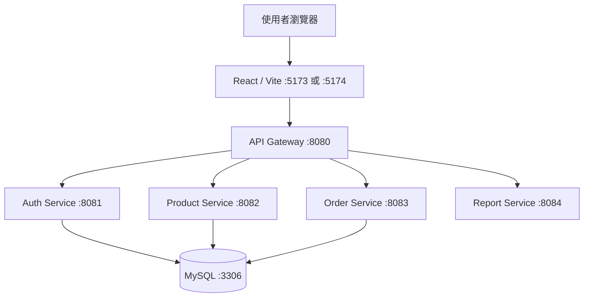

# StyleShop｜Java Spring Boot 微服務電商系統

> Java 後端工程師求職作品｜React × Spring Boot × Spring Cloud Gateway × MySQL × Docker

[GitHub 專案](https://github.com/sktedace-ops/StyleShop)

## 專案簡介

StyleShop 是一套具備前後端分離架構的電商網站專題。前端以 React 開發，後端採 Java Spring Boot 微服務設計，透過 API Gateway 統一接收前端 API 請求，並依功能分配至會員、商品、訂單及報表服務。資料庫使用 MySQL，開發環境可透過 Docker Compose 啟動 MySQL。

此專案用於展示 Java 後端開發、REST API 整合、資料庫操作、前後端串接、基本系統除錯及 Git 版本管理能力。

## 技術組合

| 類別 | 技術 | 用途 |
|---|---|---|
| 後端 | Java 21、Spring Boot 3.3.5 | 微服務 API 與商業邏輯 |
| API 閘道 | Spring Cloud Gateway | 依 API 路徑轉發請求、設定 CORS |
| 資料存取 | Spring Data JPA、Hibernate | 實體與資料庫存取（會員、商品、訂單服務啟動紀錄可見） |
| 資料庫 | MySQL 8.4 | 儲存業務資料 |
| 前端 | React、Vite | 使用者介面與 API 呼叫 |
| 建置 | Maven、npm | Java 模組建置及前端依賴管理 |
| 開發環境 | Docker Compose | 啟動 MySQL 容器 |
| 版本管理 | Git、GitHub | 分支整合、備份及版本追蹤 |

> 安全驗證方式、JWT 實作細節、API 請求與回應格式，應以實際程式碼為準，不在此文件推定。

## 系統架構



> 圖示依已知 Gateway 路由與各服務資料庫啟動紀錄繪製；Report Service 的資料來源與服務間呼叫方式仍需核對程式碼。

## 專案結構

```text
StyleShop/
├─ api-gateway/          # API 入口與 CORS 設定
├─ auth-service/         # 會員與驗證相關 API
├─ product-service/      # 商品、分類與管理相關 API
├─ order-service/        # 購物車與訂單相關 API
├─ report-service/       # 報表相關 API
├─ frontend/             # React 前端
├─ database/             # 資料庫相關檔案
├─ docker-compose.yml    # 本機 MySQL 容器
├─ pom.xml               # Maven 多模組建置
└─ README.md
```

## 核心功能

- **會員功能**：會員登入及相關會員操作。
- **商品功能**：商品列表、商品資料展示、分類瀏覽。
- **購物車**：加入商品、調整數量、查看金額。
- **訂單**：建立訂單、查看我的訂單。
- **管理後台**：管理商品資料及相關後台操作。
- **報表服務**：提供報表相關功能；實際統計欄位與匯出格式請依程式碼確認。

## API Gateway 路由

| 路徑 | 目的服務 |
|---|---|
| `/api/auth/**`、`/internal/auth/**` | Auth Service :8081 |
| `/api/products/**`、`/api/categories/**`、`/api/admin/**`、`/images/**` | Product Service :8082 |
| `/api/cart/**`、`/api/orders/**` | Order Service :8083 |
| `/api/reports/**` | Report Service :8084 |

上述為 Gateway 路徑規則，並非每條路徑都代表存在同名 API 端點；詳細 HTTP 方法與資料格式請以 Controller 程式碼為準。

## 本機啟動

### 環境需求

- JDK 21
- Maven 3.9+
- Node.js 與 npm（開發測試曾使用 Node.js 24）
- Docker Desktop 與 Docker Compose

### 1. 取得專案

```powershell
git clone https://github.com/sktedace-ops/StyleShop.git
cd StyleShop
```

### 2. 啟動資料庫

```powershell
docker compose up -d

docker compose ps
```

目前 Compose 配置主要用於啟動 MySQL；Java 微服務需另外執行。資料庫帳號、密碼及環境變數請依專案範例設定，勿將真實密碼提交至 GitHub。

### 3. 編譯 Java 微服務

```powershell
mvn clean package -DskipTests
```

`-DskipTests` 僅略過自動化測試，不表示測試已通過。正式驗證時應補跑測試。

### 4. 分別啟動五個 Java 服務

每條命令請在**不同終端機**執行，並保持終端機開啟：

```powershell
java -jar .\api-gateway\target\api-gateway-1.0.0.jar
java -jar .\auth-service\target\auth-service-1.0.0.jar
java -jar .\product-service\target\product-service-1.0.0.jar
java -jar .\order-service\target\order-service-1.0.0.jar
java -jar .\report-service\target\report-service-1.0.0.jar
```

### 5. 啟動 React 前端

```powershell
cd frontend
npm.cmd install
npm.cmd run dev
```

前端預設使用 `http://localhost:5173/`；若已被占用，Vite 可能改用 `http://localhost:5174/`。Gateway 目前的本機 CORS 設定允許這兩個來源。部署到正式環境時，應改成實際網站網域並採用對應的安全設定。

## 驗證方式

### Gateway 健康檢查

```powershell
Invoke-RestMethod -Uri "http://localhost:8080/actuator/health"
```

預期顯示 `UP`。

### 商品 API

```powershell
Invoke-WebRequest -Uri "http://localhost:8080/api/products" -UseBasicParsing |
  Select-Object StatusCode,Content
```

### 手動操作驗證

已在本機開發環境操作確認的主要流程：

- React 網站正常開啟。
- 會員登入成功。
- 商品 API 與首頁商品顯示正常。
- 購物車加入商品、調整數量與金額顯示正常。
- 訂單建立及「我的訂單」查詢正常。
- 管理後台主要操作正常。

> 以上為手動測試紀錄，並非自動化測試涵蓋率或正式上線保證；報表匯出與安全性測試需另行驗證。

## 專案開發重點

1. **服務職責拆分**：將會員、商品、訂單、報表功能分成不同服務，降低單一模組複雜度。
2. **統一 API 入口**：前端集中透過 Gateway 存取後端服務。
3. **跨來源請求排查**：處理 Vite 開發伺服器從 5173 切換到 5174 時造成的 CORS 問題。
4. **資料庫整合**：驗證服務啟動與 MySQL 連線，並以實際操作確認主要流程。
5. **版本控制**：保留 `backup-before-microservices` 備份分支，於 `integrate-microservices` 整合並更新 `main`。

## 後續改善方向

- 補齊 Controller API 文件（例如 OpenAPI / Swagger）。
- 增加單元測試、整合測試及 CI 流程。
- 驗證權限控管、密碼安全、JWT（如專案實際使用）及例外處理。
- 釐清服務間呼叫、交易一致性及報表資料來源。
- 建立可重現的部署方式、環境變數說明與正式環境 CORS 設定。
- 加入系統截圖、資料表 ER 圖與 API 範例。

## 專案定位

本專案為 Java 後端工程師求職展示作品，重點在於呈現從服務建置、資料庫連線、前後端整合到 GitHub 版本管理的實際開發與問題排查過程。
